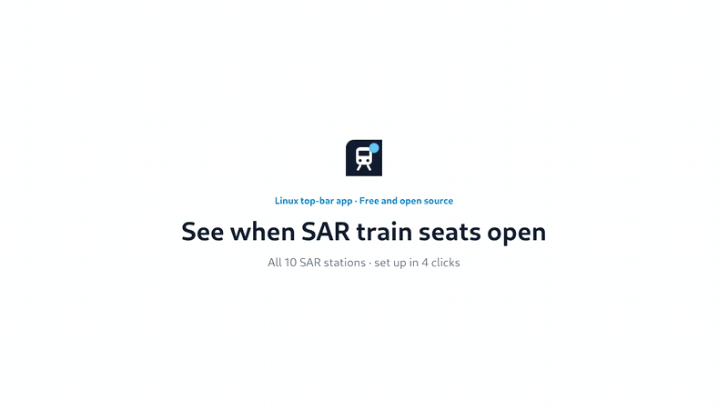

# SAR Watch

**Saudi ticket alert: see when SAR train seats open, from your Linux top bar.**


<p align="center">
  
</p>
<p align="center"><sub>The real app with real SAR data (Thu 26 Nov). The test display draws the top bar and the notification. <a href="docs/demo.mp4">Full-quality video (MP4)</a></sub></p>

## Contents

- [Features](#features)
- [Install](#install)
- [Use](#use)
- [Phone alerts](#phone-alerts-optional)
- [Server (SSH, no desktop)](#server-ssh-no-desktop)
- [Update](#update)
- [How it works](#how-it-works)
- [Safety](#safety)
- [Troubleshooting](#troubleshooting)
- [Remove](#remove)
- [Roadmap](#roadmap)
- [Contributing](#contributing)
- [Disclaimer](#disclaimer)
- [License](#license)

## Features

- Watches one day and one trip between any 2 stations on the same line.
- Shows the free seats of each class, for example "Business 1".
- Puts a **sky-blue dot** on the icon when seats are free.
- Shows a desktop notification with a sound. You can turn it off.
- Sends an alert to your phone with the free **ntfy** app. This is optional.
- Can watch only the trains you want, for example 17:30.

| Icon | Meaning |
|:---:|---|
|  | Not watching |
|  | Watching. No free seats. |
|  | **Free seats found** |
|  | The last check failed. It tries again. |

**Stations (10):**
- North Line: Riyadh, Majmaah, Qassim, Hail, Al-Jouf, Qurayyat.
- East Line: Riyadh, Hofuf, Abqaiq, Dammam.

## Install

### Option 1: With an AI agent (fast)

Use Claude Code, Codex, or another AI agent that can run terminal commands. Copy this text. Paste it into the agent.

```text
Install SAR Watch from https://github.com/abdulrahman-se/saudi-ticket-alert on my Linux computer.
Download its install.sh, read it, and tell me in short what it does. Then run: sh install.sh
Do not run sudo yourself. If the script shows sudo commands, give them to me. I run them in my terminal.
```

### Option 2: In the terminal (one command)

```bash
curl -fsSL https://raw.githubusercontent.com/abdulrahman-se/saudi-ticket-alert/main/install.sh | sh
```

No `curl` (for example on Ubuntu)? Use this:

```bash
wget -qO- https://raw.githubusercontent.com/abdulrahman-se/saudi-ticket-alert/main/install.sh | sh
```

The script does these steps:

1. It finds your Linux: Fedora, Ubuntu, Debian, Arch, and Linux that comes from them (Linux Mint, Pop!_OS, Manjaro and more).
2. It checks Python, the GTK parts and the top-bar icon support. It needs no browser.
3. It shows what is missing. It asks you before it uses `sudo`.
4. It installs SAR Watch for your user only.

Then open **SAR Watch** from your app menu. It also starts when you log in.

<details>
<summary><b>Read the script before you run it (safer)</b></summary>

```bash
curl -fsSLO https://raw.githubusercontent.com/abdulrahman-se/saudi-ticket-alert/main/install.sh
less install.sh            # read it
sh install.sh --check      # check only, change nothing
sh install.sh
```

</details>

<details>
<summary><b>Install by hand (no script)</b></summary>

**1. Install what it needs.** Copy the box for your Linux.

Ubuntu:

```bash
sudo apt install git python3-gi gir1.2-gtk-3.0 gir1.2-ayatanaappindicator3-0.1 gir1.2-notify-0.7
```

Debian:

```bash
sudo apt install git python3-gi gir1.2-gtk-3.0 gir1.2-ayatanaappindicator3-0.1 gir1.2-notify-0.7
```

Fedora:

```bash
sudo dnf install git python3-gobject gobject-introspection gtk3 libayatana-appindicator-gtk3 libnotify
```

Arch:

```bash
sudo pacman -S git python-gobject gtk3 libayatana-appindicator libnotify
```

**2. Get the app and install it.**

```bash
git clone https://github.com/abdulrahman-se/saudi-ticket-alert.git
cd saudi-ticket-alert
python3 sar_watch.py --install
```

**GNOME:** install the extension "AppIndicator and KStatusNotifierItem Support". Ubuntu has it already. KDE, Xfce and Cinnamon need nothing.

</details>

Tested on Fedora 43 GNOME (real computer), and Ubuntu 24.04, Debian 12, Fedora 43 and Arch Linux (Docker).

## Use

1. Click the train icon.
2. Click **Choose day & settings…**.
3. Select **From**, **to** and the day.
4. Click **Start watching**.

From a terminal:

```bash
python3 sar_watch.py --once 2026-11-26 --route RIY-QSM   # one check
python3 sar_watch.py --stations                          # station codes
```

For a server, see [Server (SSH, no desktop)](#server-ssh-no-desktop).

## Phone alerts (optional)

1. Install **ntfy** on your phone (App Store or Google Play).
2. In SAR Watch settings, copy the **Phone topic**.
3. In ntfy, tap **+**, type the topic, and tap **Subscribe**.
4. In SAR Watch, select **Send to iPhone or Android**.
5. Click **Send test**.

Phone alerts come only when your computer is on and SAR Watch runs. For alerts all the time, use a [server](#server-ssh-no-desktop).

Keep your topic secret. A person who knows it can read your alerts.

## Server (SSH, no desktop)

Use a server that is on all the time. Then alerts come also when your computer is off.

**1. Install.** On the server, type:

```bash
curl -fsSL https://raw.githubusercontent.com/abdulrahman-se/saudi-ticket-alert/main/install.sh | sh -s -- --server
```

It installs no desktop parts. Then it asks you questions: From, To, day, train times and phone alerts. At the end, it asks you to start the background service. Type `y`.

**2. Use these commands:**

| Command | What it does |
|---|---|
| `sar-watch --setup` | Change the trip or the phone alerts. The service uses the new settings at once. |
| `sar-watch --status` | Show the settings, the service and the last check. |
| `journalctl --user -u sar-watch -f` | Show the live log. Press Ctrl+C to stop. |
| `sar-watch --service off` | Stop the background service and remove it. |
| `sar-watch --run` | Watch in this terminal, with no service. |

**Same alerts as your computer:** in `--setup`, type the phone topic of your computer. Then both send to the same ntfy topic.

**After you log out:** the service must keep running. If `--service` shows a `sudo loginctl enable-linger` command, run it one time.

If the `sar-watch` command is not found, use `~/.local/bin/sar-watch`.

## Update

1. Click the train icon.
2. Click **Check for updates**. The settings window has the same button.
3. If a new version is ready, click **Update**.

SAR Watch keeps a copy of the old version (`sar_watch.py.bak`), then restarts. It updates only when you click.

From a terminal:

```bash
python3 ~/.local/share/sar-watch/sar_watch.py --update
```

On a server, the update restarts the background service.

## How it works

1. SAR sells the North and East trains in the **Masi** app ([masiapp.com](https://masiapp.com/)). SAR Watch asks the Masi trip search for your day and route. This is the same open search that the Masi website uses.
2. It reads the free seats of each train and class. A train with 0 seats is full.
3. It waits about 60 seconds, plus or minus a random 20 %.
4. It checks again.
5. After an error, it waits longer: 2, 4, 8, then 15 minutes at most.

> **Your computer must be on.** SAR Watch checks from your computer. If the computer is off or asleep, it does not check, and no alert comes (not on the computer, not on the phone). For alerts all the time, use a [server](#server-ssh-no-desktop).

## Safety

- It sends one small request per check. It does not log in, it uses no token and it does not book.
- It does not act as a browser and it does not go around any security. It tells Masi its name: `sar-watch`.
- It checks slowly: one check per minute or less. After an error, it waits longer.
- It opens no ports. It has no passwords. The server mode runs as your user, not as root.
- Your settings are private files (mode 600).
- It sends only the day, the route and the train times to your phone.
- It uses no extra Python packages. All parts come from your Linux system.
- Updates come only from this GitHub repo, over HTTPS, and only when you click.
- `install.sh` uses only the package repositories of your Linux. It adds no repositories and no keys. It asks before it uses `sudo`. It does not run as root.

## Troubleshooting

| Problem | Do this |
|---|---|
| Something is missing. | Run `sh install.sh --check`. It shows what is missing. |
| I cannot see the train icon. | GNOME: install the extension "AppIndicator and KStatusNotifierItem Support". Then log out and log in. |
| The icon has an orange dot. | Masi was slow or busy. Do nothing. SAR Watch tries again. |
| No alert on my phone. | Make sure that the computer is on. Use the same topic in ntfy. Click **Send test**. |
| I still see the old window after an update. | Click **Quit** in the menu. Open SAR Watch again. |

## Remove

```bash
python3 ~/.local/share/sar-watch/sar_watch.py --uninstall
```

It shows the files first. Then it asks you.

## Roadmap

- Linux: ready.
- macOS: coming soon.
- Windows: coming soon.
- Flights: planned.

## Contributing

1. For a big change, open an issue first.
2. Test your change on your Linux before you send a pull request.
3. Keep the rules: public page only, slow checks, no booking.

**Maintainer:** before you push a new version, raise `__version__` in `sar_watch.py`. The update button compares this number.

## Disclaimer

SAR Watch is an independent, free and open-source project. Saudi Arabia Railways (SAR) did not make it and does not support it. "SAR" is the name of Saudi Arabia Railways. SAR now sells the North and East trains in the Masi app. SAR Watch reads the open Masi trip search, slowly. The Masi terms do not allow bots. You use SAR Watch at your own risk.

## License

MIT. See [LICENSE](LICENSE).
